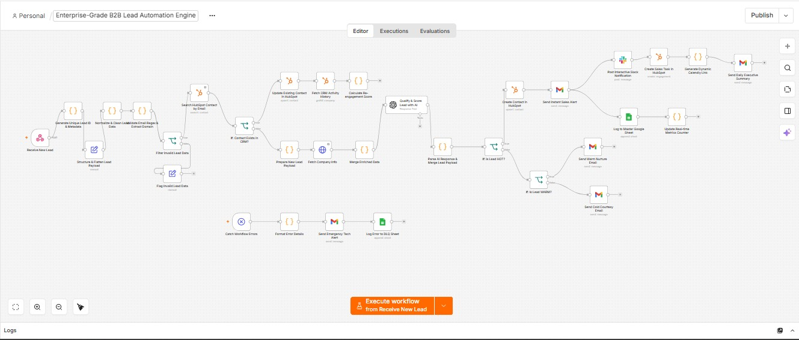

# Enterprise-Grade B2B Lead Automation Engine

**AI-Powered B2B Lead Generation, Qualification & HubSpot CRM Automation** — built with n8n, HubSpot, and OpenAI.



## Project Overview

A portfolio-grade n8n automation engine for a B2B agency. The workflow receives a lead through a POST webhook, generates a unique lead identifier, structures and cleans the payload, validates email data, checks HubSpot for an existing contact, enriches company information, uses OpenAI for qualification/scoring, routes the lead by tier, performs CRM actions, alerts sales, logs processing information, and provides a dedicated error/DLQ (dead-letter queue) path.

## Technology Stack

| Technology | Role |
|---|---|
| **n8n** | Workflow orchestration, transformation, branching, and integrations |
| **HubSpot** | Contact search, contact creation/update, and sales engagement task path |
| **OpenAI / GPT-4o-mini** | B2B lead qualification, scoring, tiering, and recommended action |
| **Gmail** | Sales alerts, nurture/courtesy emails, emergency alerts, and executive summary path |
| **Slack** | Interactive HOT-lead notification |
| **Google Sheets** | Master audit log, error/DLQ logging, and metrics path |
| **Clearbit endpoint** | Company information enrichment using email domain |
| **Calendly URL generation** | Dynamic discovery-call booking URL creation |

## Architecture

- **Intake:** Receive New Lead → Generate Unique Lead ID & Metadata → Structure & Flatten Lead Payload
- **Data quality:** Normalize & Clean Lead Data → Validate Email Regex & Extract Domain → Filter / Flag Invalid Lead Data
- **CRM deduplication:** Search HubSpot Contact by Email → Contact Exists? → Update Existing Contact OR Prepare New Lead Payload
- **Enrichment + AI:** Fetch Company Info → Merge Enriched Data → Qualify & Score Lead with AI → Parse AI Response
- **Sales routing:** HOT / WARM / COLD branches → HubSpot → Gmail / Slack → sales task → Calendly link where applicable
- **Operations:** Master Google Sheet audit log → metrics path → executive summary path
- **Reliability:** Catch Workflow Errors → Format Error Details → Emergency Tech Alert → Log Error to DLQ Sheet

## 33 Configured Nodes

| # | Node | # | Node |
|---|---|---|---|
| 1 | Receive New Lead | 18 | If: Is Lead WARM? |
| 2 | Generate Unique Lead ID & Metadata | 19 | Send Warm Nurture Email |
| 3 | Structure & Flatten Lead Payload | 20 | Send Cold Courtesy Email |
| 4 | Normalize & Clean Lead Data | 21 | Update Existing Contact in HubSpot |
| 5 | Validate Email Regex & Extract Domain | 22 | Log to Master Google Sheet |
| 6 | Filter Invalid Lead Data | 23 | Catch Workflow Errors |
| 7 | Flag Invalid Lead Data | 24 | Format Error Details |
| 8 | Search HubSpot Contact by Email | 25 | Send Emergency Tech Alert |
| 9 | If: Contact Exists in CRM? | 26 | Log Error to DLQ Sheet |
| 10 | Prepare New Lead Payload | 27 | Post Interactive Slack Notification |
| 11 | Fetch Company Info | 28 | Create Sales Task in HubSpot |
| 12 | Merge Enriched Data | 29 | Generate Dynamic Calendly Link |
| 13 | Qualify & Score Lead with AI | 30 | Fetch CRM Activity History |
| 14 | Parse AI Response & Merge Lead Payload | 31 | Calculate Re-engagement Score |
| 15 | If: Is Lead HOT? | 32 | Update Real-time Metrics Counter |
| 16 | Create Contact in HubSpot | 33 | Send Daily Executive Summary |
| 17 | Send Instant Sales Alert | | |

## AI Qualification Contract

The AI qualification node receives business-relevant lead attributes — full name, job title, company, company size, budget, timeline, service needed, and notes — and the workflow expects a raw JSON response back:

| Field | Purpose |
|---|---|
| `lead_score` | Numerical qualification score |
| `lead_tier` | Routing class such as `HOT` / `WARM` / `COLD` |
| `qualification_reason` | Human-readable explanation of the AI decision |
| `recommended_action` | Next action for the sales team |

## Reliability & Recovery

The workflow includes a dedicated n8n **Error Trigger**. Error details are transformed into failed node, error message, execution ID, execution URL, and timestamp fields, followed by an emergency technical alert and a DLQ-style Google Sheet log — giving the operator a traceable failure record.

## Portfolio Positioning

This project demonstrates more than basic n8n connectivity. It combines event-driven intake, data quality, CRM deduplication, company enrichment, AI decisioning, sales routing, multi-channel notification, audit logging, and failure observability.

> **Case-study headline:** Built an AI-powered B2B Lead Operations Engine that validates, enriches, qualifies, and routes inbound leads into HubSpot — while keeping sales teams informed and failures traceable.

## Technical Skills Demonstrated

n8n workflow architecture · Webhooks · JavaScript/Code nodes · Data normalization · Regex validation · Conditional routing · HubSpot CRM operations · OpenAI integration · HTTP APIs · Gmail automation · Slack notifications · Google Sheets logging · Error Trigger · DLQ-style failure logging · Dynamic URL generation · Operational metrics.

## Repository Contents

```
workflow/
  b2b-lead-automation-engine.json   The exported n8n workflow (credentials and personal IDs redacted)
docs/
  workflow-screenshot.jpg           Canvas screenshot of the full workflow
  Portfolio_Documentation.pdf       Full portfolio write-up
```

**No API keys, credential IDs, or personal account identifiers are included.** n8n never exports credential secrets, and this export additionally has all credential references, the n8n instance ID, personal email address, Google Sheet document IDs, Slack channel ID, and webhook IDs replaced with placeholders (e.g. `YOUR_CREDENTIAL`, `YOUR_EMAIL@example.com`, `YOUR_GOOGLE_SHEET_ID`).

## Setup

To run this workflow yourself:

1. Import `workflow/b2b-lead-automation-engine.json` into an n8n instance.
2. Connect your own credentials for HubSpot (App Token), Gmail (OAuth2), Google Sheets (OAuth2), Slack (OAuth2), and OpenAI.
3. Replace the placeholder values — email address, Google Sheet document IDs, Slack channel ID, and Calendly slug — with your own.
4. Activate the workflow and point your lead-capture form/webhook at the `Receive New Lead` webhook URL.

## Implementation Note

This document reflects the supplied workflow JSON and screenshot. The current build contains 33 configured nodes. Some auxiliary paths in the workflow — such as re-engagement scoring, metrics, and executive-summary logic — can be further connected and hardened for a production deployment. The project is best presented as a portfolio automation build with a clear path to production hardening.

---

Built by [Anupom Mojumder](https://www.linkedin.com/in/anupommojumder), AI Automation Engineer.
